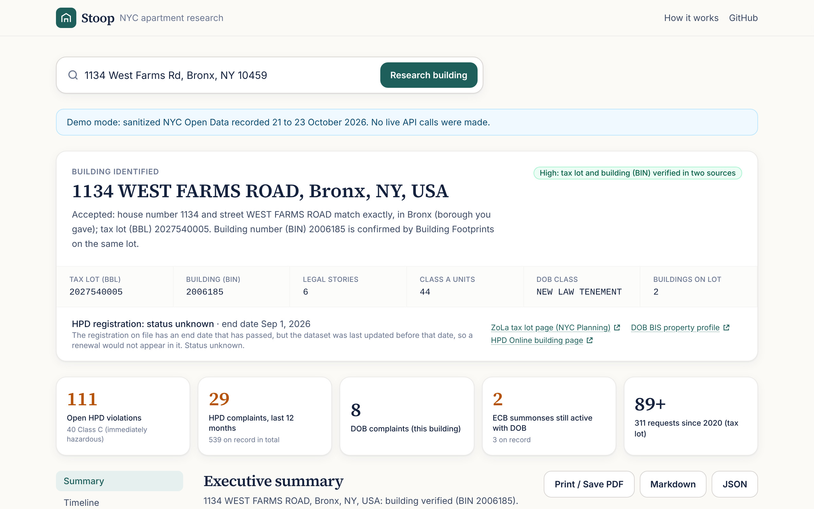
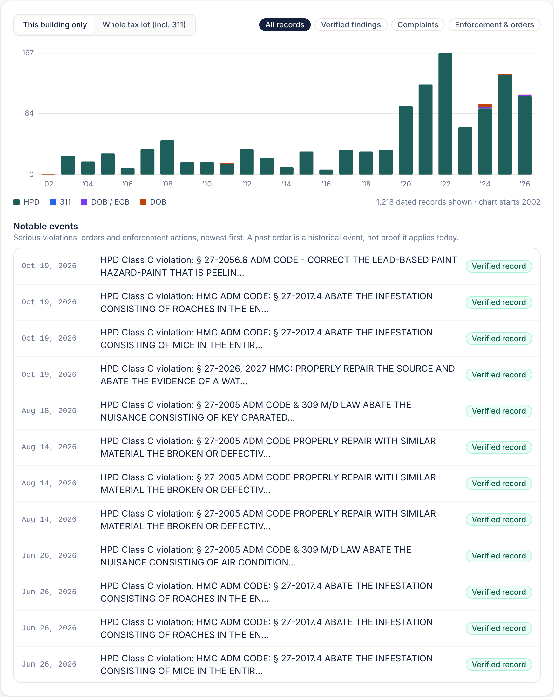
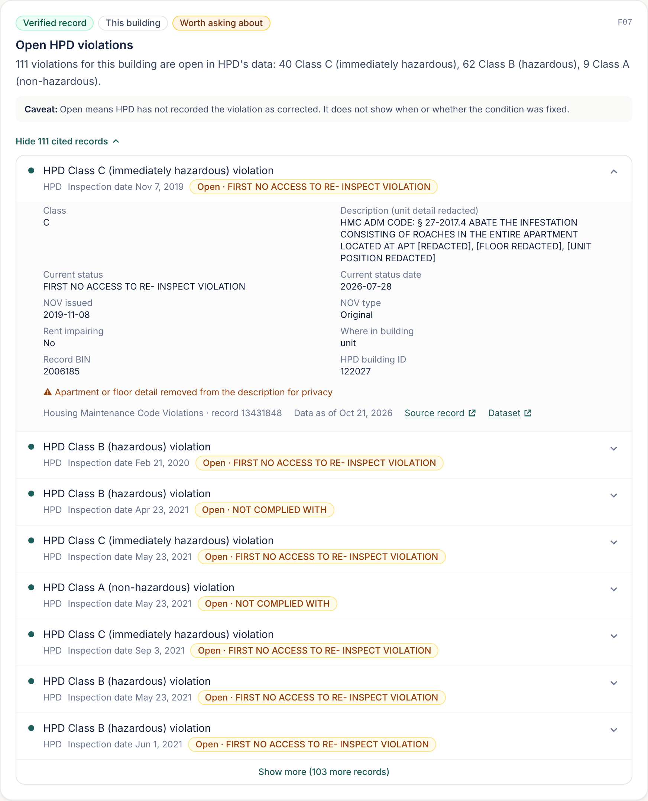
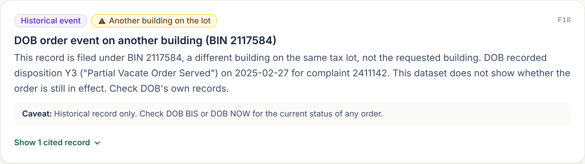
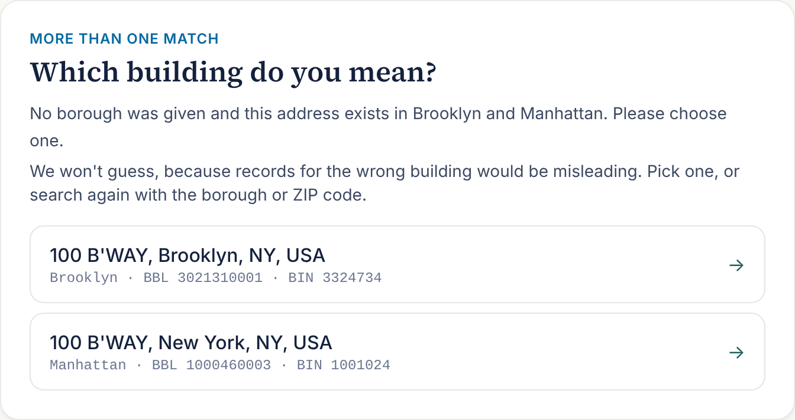
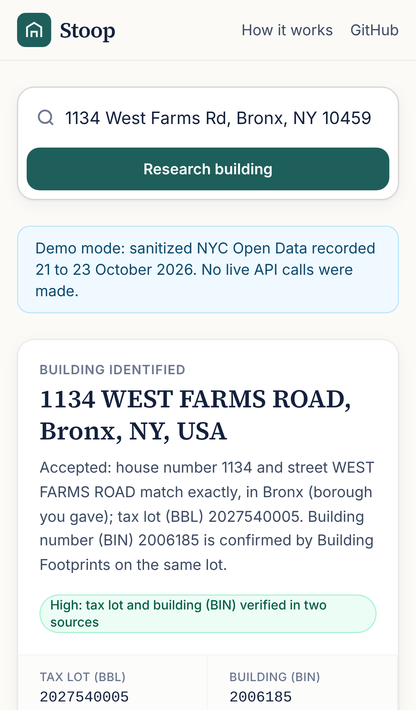
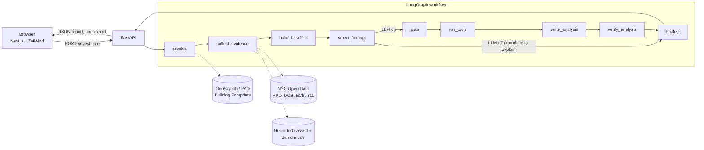

# Stoop: NYC Apartment Research Agent

Look up an NYC building before you sign a lease. Stoop finds the exact building, pulls its
official HPD, DOB, ECB and 311 records, and writes a report in which every statement cites
the city records behind it. Verified findings, tenant allegations, enforcement actions,
historical events and missing data are labelled differently, and the system says
"we can't tell" instead of guessing.

This is not legal advice, an inspection, or a judgment that an apartment is safe to rent.



| Timeline | Cited evidence |
|---|---|
|  |  |

| Another building on the same lot | Ambiguous address | Mobile |
|---|---|---|
|  |  |  |

## What it does

1. **Resolves the building.** The address is matched to a tax lot (BBL) and building (BIN)
   using NYC GeoSearch (PAD) and Building Footprints. If two candidates fit, the user picks
   one. If only the lot can be verified, building-level claims are withheld. If nothing fits
   reliably, no report is produced.
2. **Collects evidence** from six NYC Open Data datasets, each with its retrieval status,
   record count and data date. Records filed under another building on the same lot are kept
   in a separate bucket and never counted as the requested building's.
3. **Builds a deterministic baseline report.** Python computes every count and sum; each
   finding carries a category, a scope, evidence ids and a machine-checkable fact.
4. **Optionally adds an LLM explanation** through a bounded LangGraph workflow (off by
   default, at most 2 model calls). The model only sees the findings and four read-only
   tools, and every paragraph it writes must pass a verifier or it is dropped.
5. **Verifies** the whole report: every citation resolves, every count is recomputed from
   the cited records, and forbidden wording (safety verdicts, "currently in effect" orders,
   accusations) is rejected.

## Architecture



The baseline report is the report of record. The agent can add explanation but cannot change
a finding, a number or a label.

| Layer | Stack |
|---|---|
| Agent | LangGraph 1.x; Anthropic (default `claude-opus-5-5`) or OpenAI, both optional |
| Backend | Python 3.13, FastAPI, Pydantic v2, httpx, uv |
| Storage | PostgreSQL 16 with Alembic migrations, roles and retention (Phase 2 evidence store) |
| Frontend | Next.js 15, React 19, TypeScript, Tailwind CSS |
| Quality | pytest (1,244 tests incl. Postgres), ruff, Playwright E2E (desktop and mobile), GitHub Actions |
| Deploy | Docker, Render blueprint (backend), Vercel (frontend) |

## Quick start (offline, no keys)

Requires Python 3.12+, [uv](https://docs.astral.sh/uv/) and Node 20+.

```bash
# Terminal 1: API in demo mode (replays recorded, sanitized NYC data; no network)
cd backend && uv sync
DATA_MODE=demo uv run uvicorn nyc_apartment_agent.api.app:app --port 8000

# Terminal 2: web app
cd frontend && npm install && npm run dev
# open http://localhost:3000
```

Or run the API in Docker: `docker compose up api`.

Live mode queries NYC Open Data for any address: start the API with `DATA_MODE=live`
(optionally set a free `SOCRATA_APP_TOKEN`). The LLM layer needs `LLM_ENABLED=1` and an
`ANTHROPIC_API_KEY` or `OPENAI_API_KEY` on the backend. See [`.env.example`](.env.example).

### API

| Endpoint | Purpose |
|---|---|
| `POST /investigate` `{address, selected_option?}` | Full cited report (JSON) |
| `GET /reports/{id}.md`, `GET /reports/{id}.json` | Export a recent report |
| `POST /resolve` | Address resolution only |
| `GET /config`, `GET /health` | Mode, examples, liveness |

## Example addresses (demo set)

| Address | What it shows |
|---|---|
| 1134 West Farms Rd, Bronx | 666 HPD violations (111 open); a second building (BIN 2117584) on the lot whose DOB vacate-order event is kept out of this building's findings |
| 1845 Adam Clayton Powell Jr Blvd, Manhattan | Condominium: records filed under the condo billing lot 7502 as well as the base lot |
| 1217 West Farms Road, Bronx | Only the tax lot can be verified, so building claims are withheld |
| 220 West 17th Street, Manhattan | Small Chelsea building that shares its tax lot with other buildings |
| 350 5th Avenue, Manhattan | Commercial landmark: no Class A units on HPD's record, but 141 DOB complaints and 485 311 requests |
| 100 Broadway | Ambiguous: exists in Manhattan and Brooklyn, user must choose |
| 1600 Pennsylvania Ave NW, Washington DC | Outside NYC: abstains, no report |

## How citations and abstention work

- **Categories.** Each finding is one of: verified record (an agency's own finding),
  complaint/allegation, enforcement action, historical event, administrative record,
  uncertain, or unavailable.
- **Scope.** Each finding says whether it is about this building, the whole tax lot, another
  building on the lot, or a record the data cannot place.
- **Historical orders.** A stop-work or vacate order is shown as an event on a date, with a
  link to check its current status. The verifier rejects text that calls it current.
- **Missing data.** A dataset that could not be fully retrieved is labelled partial and its
  counts are shown as lower bounds ("89+"). An unavailable source is never treated as zero.
- **Privacy.** Apartment and floor numbers are redacted from free text, 311 request numbers
  and HPD contact names are withheld.

## Evaluation

`cd backend && uv run python scripts/evaluate_reports.py` (offline, about 10 s).
Full write-up: [docs/mvp_evaluation_report.md](docs/mvp_evaluation_report.md).

| Check (5 recorded buildings + 4 edge cases) | Result |
|---|---|
| Building identity matches approved labels | 9 / 9 |
| Records attributed to the wrong building | 0 |
| Citations pointing at a missing record | 0 of 6,533 |
| Counts and sums re-computed from cited records | 81 of 81 match |
| Orders presented as currently in effect | 0 |
| Known-bad LLM paragraphs that reached the report (scripted model) | 0 of 20 |
| Resolver benchmark (24 addresses) | 14/14 matches, 0 wrong building, 6/6 ambiguous, 4/4 abstentions |

These are acceptance tests on a small hand-labelled set, not citywide accuracy. The LLM arm
used a scripted model to test the guardrails; a real model's prose has not been evaluated.

## Limitations

- Covers HPD violations, complaints, building and registration records, DOB complaints, ECB
  summonses and 311. Not DOB NOW filings, court cases, rent stabilization, ownership or lead
  history.
- Open data lags the agencies' own systems. "Open" describes the record, not today's
  condition. Whether a past order is enforceable today is left as uncertain.
- Demo mode serves a snapshot recorded 21 to 23 October 2026. Live data has already changed
  for some buildings, which is why every report shows each source's data date.
- Live mode is synchronous (about 10 s); there is no job queue or report persistence yet.

## Deployment

Free-tier configs are included: `render.yaml` + `backend/Dockerfile` for the API and Vercel
for the frontend. Step-by-step: [docs/deployment.md](docs/deployment.md).

## Testing

```bash
cd backend
uv run ruff check . && uv run ruff format --check .
uv run pytest -q                                   # offline suite
TEST_DATABASE_ADMIN_URL=postgresql://... REQUIRE_DB_TESTS=1 uv run pytest -q   # + Postgres
uv run python scripts/evaluate_resolver.py         # 24-address benchmark

cd ../frontend
npm run typecheck && npm run build
npx playwright test                                # starts both servers in demo mode
```

CI (`.github/workflows/ci.yml`) runs all of the above on every push with no secrets.

## Resume bullets

- Built Stoop, an NYC apartment-research app (FastAPI, LangGraph, Next.js, PostgreSQL) that
  resolves an address to the exact building and turns 400 to 2,800 HPD, DOB, ECB and 311
  records per building into a cited report; 0 wrong-building attributions and 0 broken
  citations across 6,533 checked on a labelled evaluation set.
- Designed a verify-before-publish LLM layer: a bounded LangGraph workflow (at most 2 model
  calls, read-only tools) whose output is checked for citations, recomputed numbers and
  prohibited claims, rejecting 20 of 20 adversarial paragraphs while keeping all faithful
  ones; shipped with 1,244 tests, Playwright E2E and Docker/Vercel deploy configs.

## Repository layout

```
backend/src/nyc_apartment_agent/
  resolver/        address → BBL/BIN with typed outcomes
  sources/         one adapter per dataset (HPD, DOB, ECB, 311, GeoSearch, Footprints)
  records/         normalization, attribution, redaction
  storage/         PostgreSQL evidence store (Alembic migrations)
  investigation/   collect, baseline report, verifier, LLM clients, LangGraph agent, Markdown
  api/             FastAPI app
backend/tests/     unit, db, live (opt-in) tests; fixtures/ holds the sanitized cassettes
frontend/          Next.js app, Playwright E2E
data/eval/         labelled addresses, benchmark and evaluation results
docs/              design notes, phase reports, evaluation, deployment
```

## License

Source code: MIT, see [LICENSE](LICENSE). Data and dependencies keep their own terms, see
[THIRD_PARTY_NOTICES.md](THIRD_PARTY_NOTICES.md).
